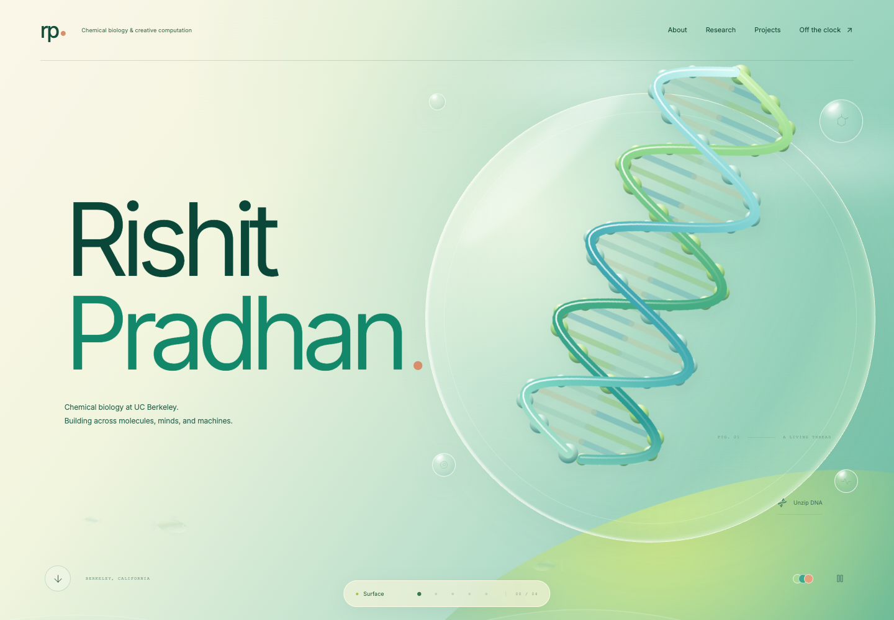

# Rishit Pradhan — Portfolio

An interactive personal site at the intersection of chemical biology, computation, and playful interfaces.

**[Visit rishitpradhan.com ↗](https://rishitpradhan.com)**



## Explore

- **A living DNA environment:** rotate and separate the complementary strands, pop bubbles, and scroll through an aquatic scene with swimming fish.
- **Research:** expandable context and source links for UCSF, CDPH, and LBNL/JGI.
- **Project pages:** DreamIT world-building concepts, a recorded Drip prototype, and a live reaction–diffusion pattern lab.
- **Off the clock:** a playable tennis-inspired arcade game with scoring, an opponent, three lives, and a local best score.
- **Motion controls:** reduced-motion support, ambient pause, hidden-tab handling, and viewport-aware video playback.

## Run

Node.js 22.17+ and npm are recommended.

```sh
npm ci
npm run dev
```

```sh
npm run typecheck
npm run build
```

Next.js exports the static site to `out/`. Serve that directory with any static host. The deployed site uses Vercel.

## Project structure

- `app/` — page routes, metadata, and styles.
- `components/worlds/` — DNA, fish, and aquatic effects.
- `components/projects/` — project media, prototype recording, and interactive previews.
- `components/play/` — tennis game.
- `components/sections/` — portfolio content sections.
- `data/` — project notes, media metadata, research context, and source links.
- `scripts/` — browser verification and prototype-recording utilities.

## Standalone experiments

The interactive work also has focused repositories with independent app shells, extracted models, tests, and implementation notes:

- [Morphogenesis Lab](https://github.com/rishitpradhan-gif/morphogenesis-lab) — reaction–diffusion simulation and paintable patterns.
- [Rally Court](https://github.com/rishitpradhan-gif/rally-court) — canvas game and collision physics.
- [World Garden](https://github.com/rishitpradhan-gif/world-garden) — isometric geometry and a garden-building sandbox.
- [Wearable Signal Lab](https://github.com/rishitpradhan-gif/wearable-signal-lab) — simulated signals and a reactive interface.

These are experiments derived from this portfolio. The world and wearable previews are separate from the DreamIT and Drip production products; local avatars and wearable measurements are simulated.

## Browser verification

After a production build, serve the export:

```sh
python3 -m http.server 3000 --directory out
```

In another terminal, with Google Chrome installed:

```sh
node scripts/verify.mjs
node scripts/verify-play.mjs
node scripts/verify-motion.mjs
```

The checks cover navigation, project media, dialogs, live simulation controls, real game scoring, PNG export, reduced motion, video playback, and mobile overflow. The pattern check updates its actual-output preview image.

## Media and research credits

- The DreamIT image is original concept artwork generated for this portfolio, not a product screenshot.
- Drip imagery and the silent local video capture the existing public prototype. They show illustrative data, not a live device connection.
- The JGI photograph is from the [official 2024 CalTeach internship story](https://jgi.doe.gov/user-science/science-stories/exploring-and-thinking-critically-about-scientific-problems-jgi), credited to Sajeet Haridas/JGI.
- Research descriptions distinguish general context from sourced details and do not include patient or confidential research data.

Source code and media have different rights. Third-party material and dependency licenses remain with their respective owners. See [media credits](docs/media-credits.md).
